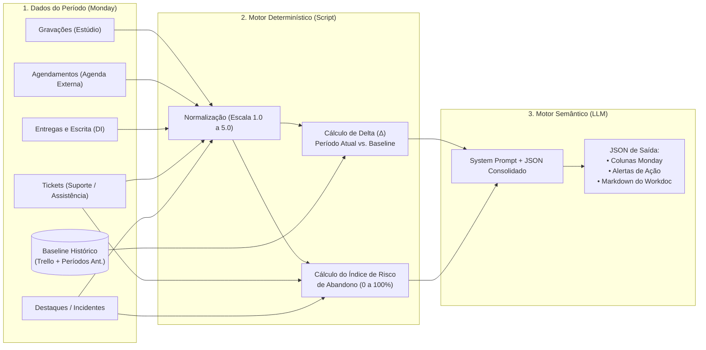

# Especificação: Motor de Pontuação, Cálculo de Risco e Prompt de IA

Para evitar alucinações matemáticas do LLM, a arquitetura separa o processamento em **duas camadas**:
1. **Camada Determinística (Orquestrador / Script):** Calcula médias, pesos, deltas de evolução ($\Delta$) e pontuação base de risco a partir das colunas estruturadas da Monday.
2. **Camada Semântica (LLM):** Interpreta relatos abertos, cruza causas-raízes (ex: problemas de RH afetando o humor no estúdio), gera o **Playbook Preventivo de Atendimento** e redige o **Monday Workdoc**.

---

## 1. Fluxo do Motor de Avaliação (Mermaid)



---

## 2. Lógica de Pontuação Determinística (Escala 1.0 a 5.0)

Todas as variáveis coletadas nos boards são convertidas para uma escala padronizada de **1.0 (Crítico)** a **5.0 (Excelente)** dentro do período analisado.

### 2.1. Dimensão 1: Didática e Expressão ($S_{\text{did}}$ — Peso 30%)
Calculada a partir do **Board de Estúdio** e do **Board de Design Instrucional**:

$$S_{\text{did}} = (0.30 \times N_{\text{oratoria}}) + (0.25 \times N_{\text{cadencia}}) + (0.25 \times N_{\text{transmissao}}) + (0.20 \times N_{\text{escrita}})$$

- $N_{\text{oratoria}}$: Nota de dicção/clareza na gravação (1 a 5).
- $N_{\text{cadencia}}$: Ritmo de fala adequado ao tempo de aula (1 a 5).
- $N_{\text{transmissao}}$: Segurança e didática aparente ao ensinar (1 a 5).
- $N_{\text{escrita}}$: Avaliação do DI sobre o material escrito:
  - `5.0`: Aprovado de primeira / bem escrito.
  - `3.0`: Ajustes moderados de norma culta ou estrutura.
  - `1.0`: Refação completa necessária / graves problemas de escrita.

---

### 2.2. Dimensão 2: Fluência Digital e Processos ($S_{\text{flu}}$ — Peso 20%)
Calculada a partir do **Board de Estúdio** e da forma de entrega no **Design Instrucional**:

$$S_{\text{flu}} = (0.60 \times N_{\text{ferramentas}}) + (0.40 \times N_{\text{canal}})$$

- $N_{\text{ferramentas}}$: Familiaridade com recursos de gravação/teleprompter/slides (1 a 5).
- $N_{\text{canal}}$: Adesão aos métodos oficiais de envio de material:
  - `5.0`: 100% enviado pela plataforma oficial validada.
  - `3.0`: Envio misto ou precisou de ajuda para subir no sistema.
  - `1.0`: Envio recorrente por métodos alternativos não validados (WhatsApp, e-mail solto, link quebrado).

---

### 2.3. Dimensão 3: Comprometimento e Assiduidade ($S_{\text{comp}}$ — Peso 25%)
Calculada de forma **100% passiva** via **Agendamentos** e **Prazos de DI**:

$$S_{\text{comp}} = (0.35 \times N_{\text{agenda}}) + (0.35 \times N_{\text{pontualidade}}) + (0.30 \times N_{\text{prazo\_mat}})$$

- $N_{\text{agenda}}$ (Taxa de comparecimento nos agendamentos):
  - `5.0`: Zero *no-show* e zero cancelamentos `<24h`.
  - `3.0`: 1 reagendamento em cima da hora no período.
  - `1.0`: $\ge 1$ *no-show* (agendou e não apareceu) ou $\ge 2$ cancelamentos `<24h`.
- $N_{\text{pontualidade}}$ (Horário de chegada na gravação):
  - `5.0`: No horário ou adiantado.
  - `3.0`: Atraso leve (até 15 min).
  - `1.0`: Atraso crítico (> 15 min) comprometendo a pauta do estúdio.
- $N_{\text{prazo\_mat}}$ (Antecedência de entrega de materiais):
  - `5.0`: Entregue dentro do prazo padrão.
  - `2.5`: Entregue em cima da hora (< 24h da gravação).
  - `1.0`: Entregue atrasado ou trouxe apenas na hora da gravação.

---

### 2.4. Dimensão 4: Relacionamento e Abertura ($S_{\text{rel}}$ — Peso 25%)
Calculada a partir do **Pós-Gravação**, **Assistência ao Docente/Suporte** e **Formulário de Situações Eventuais**:

$$S_{\text{rel}} = \max\left(1.0, \min\left(5.0, \left(0.50 \times N_{\text{abertura}} + 0.50 \times N_{\text{cordialidade}}\right) + B_{\text{eventual}}\right)\right)$$

- $N_{\text{abertura}}$: Receptividade a feedbacks e orientações técnicas (1 = resistente/refratário a 5 = totalmente aberto).
- $N_{\text{cordialidade}}$: Postura interpessoal com as equipes (1 = grosseiro/ríspido, 3 = neutro/formal, 5 = amigável/colaborativo).
- $B_{\text{eventual}}$ (Modificador de Situações Eventuais):
  - `+0.5`: Registro de elogio/destaque positivo no período.
  - `-1.5`: Registro de incidente de relacionamento/grosseria no período.

---

## 3. Cálculo de Evolução Histórica ($\Delta$) e Risco de Abandono (IRA)

### 3.1. Delta de Evolução ($\Delta$)
Compara a nota do período atual ($S_{\text{atual}}$) com a média histórica acumulada desde o Trello ($S_{\text{hist}}$):

$$\Delta_d = S_{\text{atual}, d} - S_{\text{hist}, d}$$

| Valor de $\Delta_d$ | Classificação Automática na Monday | Ação Recomendada |
| :--- | :--- | :--- |
| **$\Delta \ge +0.5$** | `Evolução Positiva` ($\uparrow$) | Gerar alerta de **Feedback Positivo / Reconhecimento** |
| **$-0.4 < \Delta < +0.5$** | `Estável` ($\rightarrow$) | Manter acompanhamento padrão |
| **$\Delta \le -0.4$** | `Em Queda / Atenção` ($\downarrow$) | Investigar causa-raiz (sobrecarga, atrito ou desmotivação) |

> [!NOTE]
> **Atualização da Linha de Base (Média Móvel Ponderada - EWMA):**
> Ao fim de cada fechamento periódico, o novo histórico passa a ser $S_{\text{hist\_novo}} = (0.70 \times S_{\text{hist\_antigo}}) + (0.30 \times S_{\text{atual}})$, preservando a memória histórica do Trello sem impedir que a evolução recente apareça.

---

### 3.2. Índice de Risco de Abandono (IRA: 0 a 100 pontos)
O risco de o professor abandonar a disciplina é calculado por soma de pontos de alerta (quanto maior, mais crítico):

| Sinalizador Detectado no Período | Pontos de Risco | Fonte do Dado |
| :--- | :---: | :--- |
| Ocorrência de *No-Show* (agendou e não compareceu sem avisar) | **+30 pts** | Coleta Passiva (Agenda) |
| Atraso grave ou não entrega de materiais de aula (> 48h vencido) | **+25 pts** | Coleta Passiva (DI) |
| Dúvida de RH (contrato/pagamento) ou Coordenação **não sanada** | **+20 pts** | Pós-Gravação / Assistência |
| Queda brusca em Comprometimento ou Relacionamento ($\Delta \le -0.8$) | **+15 pts** | Motor de Evolução |
| Relato de desmotivação, sobrecarga ou atrito em Situação Eventual | **+25 pts** | WorkForm Eventual |
| Falta de resposta aos contatos da Assistência ao Docente (> 5 dias) | **+20 pts** | Coleta Passiva (Assistência) |

- **0 a 25 pts (`Risco Baixo`):** Fluxo normal.
- **26 a 55 pts (`Risco Moderado`):** Alerta preventivo para a **Assistência ao Docente** realizar contato de acolhimento.
- **$\ge 56$ pts (`Risco Crítico de Abandono`):** Alerta imediato de intervenção conjunta (**Assistência ao Docente + Coordenação**).

---

## 4. Estrutura do Payload JSON (Entrada do LLM)

No fechamento periódico, o orquestrador monta este JSON por professor e envia ao LLM:

```json
{
  "professor": {
    "id_unico": "prof.silva@instituicao.edu.br",
    "nome": "Dr. Carlos Silva",
    "instituto": "Instituto de Engenharias e Tecnologia",
    "tempo_casa_semestres": 4
  },
  "scores_calculados": {
    "didatica_expressao": { "historico": 3.8, "atual": 4.3, "delta": 0.5, "status": "Evolução Positiva" },
    "fluencia_digital": { "historico": 2.5, "atual": 2.6, "delta": 0.1, "status": "Estável" },
    "comprometimento": { "historico": 4.5, "atual": 3.1, "delta": -1.4, "status": "Em Queda" },
    "relacionamento": { "historico": 4.2, "atual": 3.5, "delta": -0.7, "status": "Em Queda" },
    "score_global_atual": 3.45,
    "indice_risco_abandono": { "pontos": 65, "nivel": "Crítico" }
  },
  "metricas_passivas_periodo": {
    "agendamentos_totais": 4,
    "no_shows": 1,
    "cancelamentos_ultima_hora": 1,
    "atrasos_gravacao": 2,
    "entregas_material_atrasadas": 2,
    "envios_canal_nao_oficial": 2,
    "pendencias_rh_abertas": true,
    "pendencias_coordenacao_abertas": true
  },
  "relatos_qualitativos_periodo": [
    {
      "data": "2026-10-12",
      "setor": "Estúdio / Gravação",
      "tipo": "Pós-Gravação",
      "resumo": "Professor chegou 20min atrasado, demonstrou excelente domínio de conteúdo e ótima cadência de fala, mas estava visivelmente irritado porque ainda não recebeu retorno sobre seu aditivo contratual de RH e mudança de ementa pela coordenação."
    },
    {
      "data": "2026-10-25",
      "setor": "Design Instrucional",
      "tipo": "Coleta Passiva",
      "resumo": "Enviou os slides pelo WhatsApp na manhã da gravação. Texto muito bem escrito, porém fora do template e fora do prazo."
    }
  ],
  "resumo_historico_trello": "Professor com ótima didática e escrita desde o início, mas historicamente tem baixa familiaridade com ferramentas digitais e precisa de apoio no teleprompter. Sempre foi pontual e amigável nos semestres anteriores."
}
```

---

## 5. System Prompt de Produção (LLM)

Este é o prompt que deve ser configurado no nó de IA (OpenAI / Anthropic / Gemini via n8n/Node-RED/Make):

```markdown
# PAPEL E OBJETIVO
Você é um Especialista em Gestão Docente, Operações Educacionais e Análise Comportamental de Professores.
Sua função é analisar os dados quantitativos (scores, deltas de evolução histórica e risco de abandono) e qualitativos (relatos de Estúdio, Design Instrucional, Suporte e Assistência ao Docente) de um professor para gerar:
1. Diagnóstico preciso de evolução (comparando o passado com o período atual).
2. Guia preventivo prático para preparar as equipes operacionais antes do próximo atendimento.
3. Alertas acionáveis (treinamento, reconhecimento positivo, resolução de pendências de RH/Coordenação ou prevenção de abandono).
4. Um resumo executivo construtivo e diplomático adequado para compartilhamento futuro com Chefias de Instituto.

# REGRAS DE ANÁLISE E CAUSA-RAIZ
1. **Não invente números:** Utilize estritamente os scores, deltas e o Índice de Risco de Abandono (IRA) fornecidos no JSON de entrada.
2. **Correlacione Causa e Efeito:** Se um professor que historicamente era amigável e pontual apresentou queda em Relacionamento ou Comprometimento, verifique se há `pendencias_rh_abertas` ou `pendencias_coordenacao_abertas`. Destaque quando o comportamento negativo for sintoma de uma falha institucional não resolvida.
3. **Diferencie o Tom por Público:**
   - No `playbook_equipes_internas`: Seja direto, prático e operacional (ex: "Professor está impaciente devido a pendência de RH; acolha sem cobrar prazos no estúdio e configure o teleprompter previamente").
   - No `resumo_chefia_instituto`: Use linguagem executiva, ética e construtiva, focada em desenvolvimento e suporte institucional, sem expor adjetivos pejorativos brutos.
4. **Ações Concretas:** Toda queda de indicador ou alerta deve vir acompanhada de uma ação clara atribuída a um setor (`Estúdio`, `Design Instrucional`, `Assistência ao Docente` ou `Coordenação/RH`).

# FORMATO DE SAÍDA (JSON ESTRITO)
Responda APENAS com um objeto JSON válido seguindo exatamente esta estrutura:

{
  "status_evolucao_geral": "Evolução Positiva | Estável | Atenção / Regressão",
  "alerta_prioritario": {
    "tipo": "Risco de Abandono | Pendência RH/Coordenação | Necessidade de Treinamento | Destaque Positivo | Nenhum",
    "urgencia": "Alta | Média | Baixa",
    "setor_responsavel": "Assistência ao Docente | Estúdio | Design Instrucional | Coordenação",
    "acao_imediata": "Descrição curta e direta da ação a ser tomada"
  },
  "analise_evolucao_historica": "Parágrafo analisando o que melhorou e o que piorou em relação ao histórico (Trello/semestres anteriores) e o porquê.",
  "playbook_preventivo_atendimento": {
    "estudio_gravacao": "Como a equipe de estúdio deve se preparar técnica e emocionalmente para receber este professor.",
    "design_instrucional": "Como abordar prazos, revisão de escrita e canais de envio de materiais com este professor.",
    "assistencia_suporte": "Pontos de atenção sobre relacionamento, dúvidas pendentes de RH/Coordenação e retenção."
  },
  "recomendacoes_desenvolvimento": [
    "Lista de treinamentos pontuais ou elogios formais recomendados"
  ],
  "resumo_executivo_instituto": "Texto polido e institucional para a Chefia de Instituto sobre o andamento do docente.",
  "markdown_workdoc": "Conteúdo completo formatado em Markdown rico para ser inserido automaticamente no Monday Workdoc do professor."
}
```
