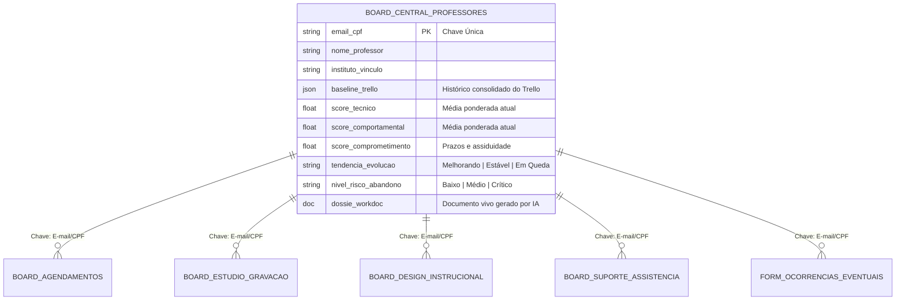
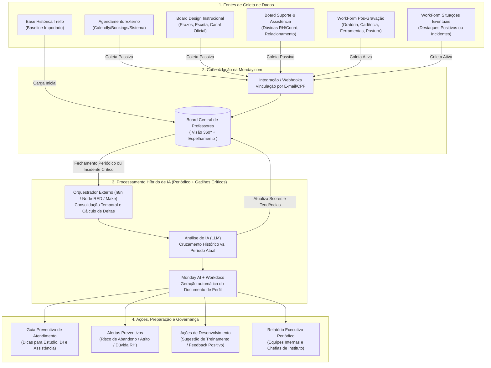

# Projeto: Sistema Inteligente de Perfil e Evolução Docente (Monday.com + IA)

## 1. Visão Geral e Objetivos
Migração e expansão do modelo atual de avaliação pós-gravação (Trello) para um ecossistema centralizado na **Monday.com**, integrando coleta de dados **ativa** e **passiva** de múltiplos setores (**Estúdio/Gravação**, **Design Instrucional**, **Suporte/Tutoria** e **Assistência ao Docente**).

### Objetivos Principais
- **Preparação Preventiva das Equipes:** Fornecer às equipes operacionais um perfil atualizado do docente antes de cada interação ou gravação, antecipando necessidades técnicas ou comportamentais.
- **Monitoramento de Evolução (Análise Longitudinal):** Medir a curva de aprendizado e adaptação do professor ao longo do tempo (preservando a linha de base histórica do Trello).
- **Ações Preditivas por IA:** Identificar padrões de risco (ex: abandono de disciplina, fadiga, falhas de comunicação com coordenação/RH) e oportunidades (ex: professores destaque, recomendação de treinamentos específicos).
- **Relatórios Executivos Periódicos:** Gerar dossiês consolidados em **Monday Workdocs** para as equipes internas e, em segunda fase, para as **Chefias de Instituto**.

---

## 2. Arquitetura de Dados na Monday.com

A estrutura baseia-se em um **Modelo Relacional Centralizado**, onde o **E-mail Institucional (ou CPF)** atua como chave única (`Unique ID`) conectando todos os boards operacionais ao Board Central via colunas **Connect Boards** e **Mirror**.

---

## 3. Plano de Coleta de Dados (Passiva vs. Ativa)

O sistema minimiza o atrito operacional priorizando a **coleta passiva** (subproduto natural do trabalho diário nos boards) combinada com **coleta ativa pontual** (pós-gravação e incidentes).

### 3.1. Coleta Passiva (Automática via Fluxo de Trabalho dos Setores)

| Fonte / Setor | Origem do Dado | Indicadores Extraídos Automaticamente | Como é Calculado |
| :--- | :--- | :--- | :--- |
| **Agendamento (Sistema Externo -> Monday)** | Webhook/Integração do sistema de agenda externa para o Board de Agendamentos | • Taxa de *No-Show* (não comparecimento) • Índice de reagendamento em cima da hora • Antecedência de marcação | Diferença entre `Data da Solicitação` e `Data da Sessão`; Contagem de status `Cancelado <24h` ou `Ausente`. |
| **Design Instrucional / Revisão de Materiais** | Board de Produção de Materiais / Validação | • Pontualidade na entrega de materiais • Uso de canais alternativos não oficiais • Qualidade da escrita (índice de refação) | Comparação `Data Entrega Real` vs `Prazo Limite`; Flag de canal de recebimento (`Plataforma Oficial` vs `WhatsApp/E-mail solto`); Nº de ciclos de revisão textual. |
| **Assistência ao Docente & Suporte/Tutoria** | Board de Chamados / Atendimento ao Docente | • Dúvidas recorrentes não sanadas (RH, Coordenação) • Problemas de comunicação/relacionamento • Tempo de resposta do professor | Tags de categorização do chamado (`Dúvida RH`, `Falta Alinhamento Coordenação`); SLA de retorno do docente quando acionado pela equipe. |

### 3.2. Coleta Ativa (Formulários Rápidos / WorkForms)

1. **Formulário Pós-Gravação (Estúdio):** Evolução direta do formulário atual do Trello, preenchido imediatamente após a sessão de gravação:
   - **Pontualidade na sessão:** No horário / Atraso leve (<15min) / Atraso crítico (>15min).
   - **Domínio de Ferramentas e Estúdio:** Autônomo / Precisa de auxílio pontual / Alta dificuldade.
   - **Oratória e Didática:** Clareza, cadência de fala, capacidade aparente de transmitir conhecimento (Escala 1 a 5).
   - **Receptividade e Clima:** Aberto a orientações, amigável, neutro, resistente ou ríspido/grosseiro.
   - **Alinhamento Prévio:** Chegou com dúvidas de RH ou de coordenação não resolvidas? (Sim/Não + Detalhe).
2. **Formulário de Destaque / Ocorrência Eventual (Todos os Setores):**
   - WorkForm disponível para **Estúdio, DI, Suporte e Assistência ao Docente** para registrar eventos fora da curva (tanto **elogios/destaques positivos** quanto **atritos graves, grosserias ou sinais de desistência**).

---

## 4. Fluxo de Trabalho Completo (Mermaid)

---

## 5. Dimensões do Perfil e Motor de Avaliação (IA Híbrida)

Para medir a **evolução histórica** e gerar diagnósticos precisos, os dados coletados são agrupados em **4 Dimensões**, comparando a média dos últimos registros com o **Baseline Histórico (Trello + semestres anteriores)**:

### 5.1. Matriz das 4 Dimensões
1. **Didática e Expressão (Peso 30%):**
   - *Variáveis:* Fala bem, cadência de fala, aparente domínio e transmissão do conteúdo, qualidade da escrita nos materiais.
   - *Ação recomendada se baixo:* Oficina de oratória/câmera ou apoio intensivo do Design Instrucional.
2. **Fluência Digital e Ferramentas (Peso 20%):**
   - *Variáveis:* Familiaridade com ferramentas de estúdio/gravação, envio de arquivos pelos métodos validados pela instituição (vs. envio improvisado).
   - *Ação recomendada se baixo:* Treinamento técnico rápido antes da gravação + alocação de operador sênior no estúdio.
3. **Comprometimento e Organização (Peso 25%):**
   - *Variáveis:* Pontualidade nas gravações, taxa de *no-show*/reagendamento na agenda externa, envio de materiais no prazo (vs. última hora).
   - *Ação recomendada se baixo:* Lembretes automatizados reforçados pela Assistência ao Docente + alerta de risco de atraso no cronograma.
4. **Relacionamento e Abertura (Peso 25%):**
   - *Variáveis:* Abertura às orientações, cordialidade (amigável vs. grosseiro), histórico de atritos com equipes ou coordenação, dúvidas de RH pendentes.
   - *Ação recomendada se baixo:* **Guia de Preparação Emocional** para a equipe que vai atendê-lo + acionamento preventivo da Assistência ao Docente/RH para sanar pendências antes da gravação.

### 5.2. Regras Preditivas de Alerta (Motor Externo + IA)
Durante a consolidação periódica (ou imediatamente quando o *Formulário de Situações Eventuais* registra uma ocorrência grave), o prompt estruturado da IA avalia:

> [!IMPORTANT]
> **Gatilho de Risco de Abandono de Disciplina:**
> Combinação de: Aumento de *no-show*/reagendamentos + Atraso ou não envio de materiais no DI + Relato de frustração/dúvidas de RH ou Coordenação não sanadas na Assistência ao Docente.
> **Ação:** Alerta imediato para Assistência ao Docente intervir preventivamente.

> [!TIP]
> **Gatilho de Evolução Positiva (Feedback de Reconhecimento):**
> Quando o Delta ($\Delta = \text{Score Atual} - \text{Score Histórico}$) sobe mais de 20% em Oratória, Ferramentas ou Pontualidade.
> **Ação:** Destaque no relatório periódico para elogio formal da coordenação/chefia.

---

## 6. Estrutura do Documento Automático (Monday Workdocs)

A cada ciclo de consolidação periódica, a automação gera/atualiza um **Workdoc padronizado** vinculado ao item do professor no Board Central:

1. **Resumo Executivo (Gerado por IA):** Parágrafo síntese sobre o momento atual do professor e sua evolução desde o início dos registros (incluindo histórico Trello).
2. **Radar de Indicadores:** Notas de 1 a 5 nas 4 dimensões + seta de tendência ($\uparrow$ Melhorou, $\rightarrow$ Estável, $\downarrow$ Piorou).
3. **Playbook Preventivo de Atendimento ("Como atender este professor"):**
   - *Para o Estúdio:* Ex: "Professor costuma atrasar 10min e sente insegurança com o teleprompter; separar 5min iniciais para acolhimento técnico."
   - *Para DI / Assistência:* Ex: "Costuma enviar materiais por e-mail em vez do sistema; reforçar link oficial 48h antes do prazo."
4. **Pendências Institucionais Detectadas:** Registro de dúvidas de RH ou falhas de alinhamento com coordenação que impactaram o docente no período.
5. **Recomendações de Ação:** Treinamentos sugeridos, necessidade de mediação ou reconhecimento positivo.

---

## 7. Governança e Fases de Implementação

### Controle de Acesso e Privacidade
- **Fase 1 (Acesso Interno Restrito):** O Board Central e os Workdocs de perfil ficam visíveis exclusivamente para as lideranças e equipes internas envolvidas (**Estúdio, Design Instrucional, Suporte e Assistência ao Docente**).
- **Fase 2 (Visão Executiva para Chefias de Instituto):** Após validação do modelo, criação de uma **Visualização Filtrada / Relatório Executivo** por Instituto, onde os dados brutos sensíveis (ex: relato literal de grosseria) são traduzidos pela IA em indicadores construtivos de gestão ("Necessita alinhamento sobre fluxos institucionais e comunicação").

### Roadmap de Execução
1. **Etapa 1 — Saneamento e Migração do Trello (Semana 1-2):**
   - Extração dos cartões históricos do Trello, unificação por nome/e-mail do professor e geração de um JSON/resumo de "Baseline Histórico" para cada docente.
2. **Etapa 2 — Construção dos Boards e WorkForms na Monday (Semana 2-3):**
   - Criação do **Board Central de Professores** e conexão com os boards de **Estúdio**, **DI**, **Suporte/Assistência** e **Agendamentos**.
   - Criação do **WorkForm Pós-Gravação** e do **WorkForm de Situações Eventuais**.
3. **Etapa 3 — Integração de Coleta Passiva (Semana 3-4):**
   - Conexão via Webhook/API da ferramenta externa de agendamento para alimentar automaticamente comparecimentos, cancelamentos e atrasos.
   - Configuração de colunas de data/status nos boards de DI e Assistência para medir prazos e canais de envio sem trabalho manual extra.
4. **Etapa 4 — Automação de IA e Workdocs (Semana 5-6):**
   - Configuração do fluxo periódico (n8n/Node-RED/Make + API Monday + LLM) para ler os registros do período, comparar com a linha histórica, atualizar os scores e gerar o **Monday Workdoc** de Perfil.
5. **Etapa 5 — Operação Assistida e Expansão (Semana 7+):**
   - Rodada piloto com as equipes internas; calibração dos pesos da IA e liberação gradual dos relatórios para as Chefias de Instituto.

---

## 8. Backlog de Próximos Entregáveis Técnicos

- [x] **Plano de Coleta de Dados e Arquitetura Geral + Fluxos Mermaid** (`plano_perfil_professor_monday.md`)
- [x] **Desenho do Prompt de IA e Lógica de Pontuação (Scores, Deltas e Risco de Abandono)** (`motor_ia_e_pontuacao.md`)
- [ ] **Dicionário de Dados da Monday.com:** Especificação exata das colunas de cada Board e perguntas dos WorkForms (*Pós-Gravação* e *Situações Eventuais*).
- [ ] **Migração Trello → Monday:** Mapeamento dos cartões atuais do Trello e script de consolidação para gerar o *Baseline Histórico* inicial de cada professor.
- [ ] **Implementação da Automação Externa:** Construção do fluxo técnico (Webhook Agenda Externa + GraphQL API Monday + Orquestrador + LLM) para cálculo periódico e criação automática dos Workdocs.

